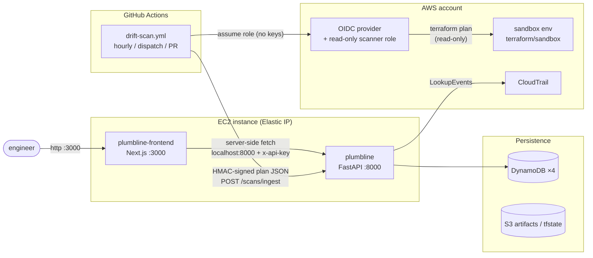
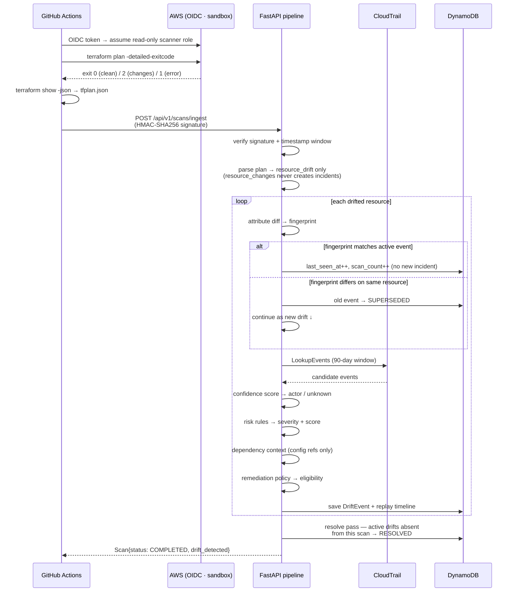
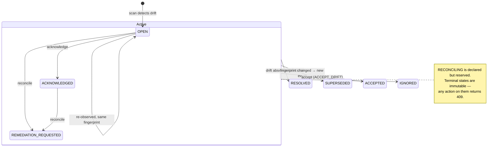
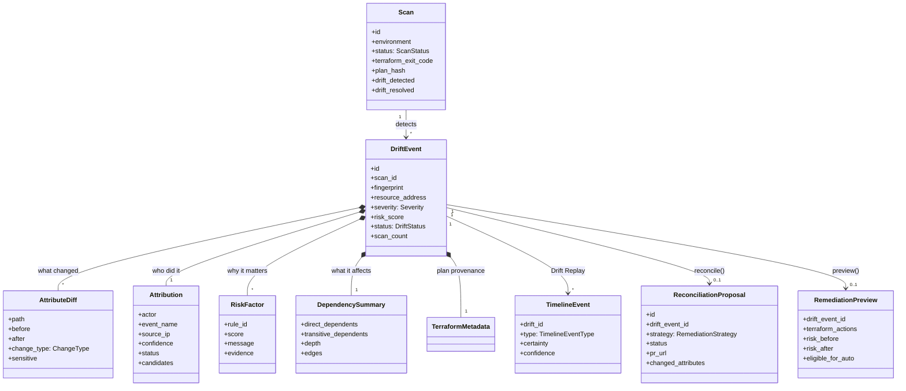
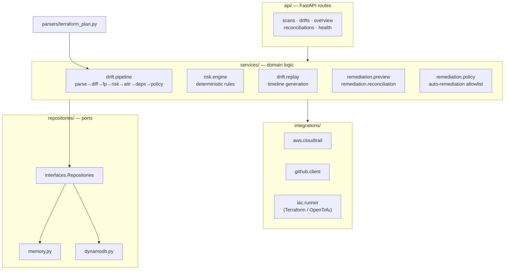
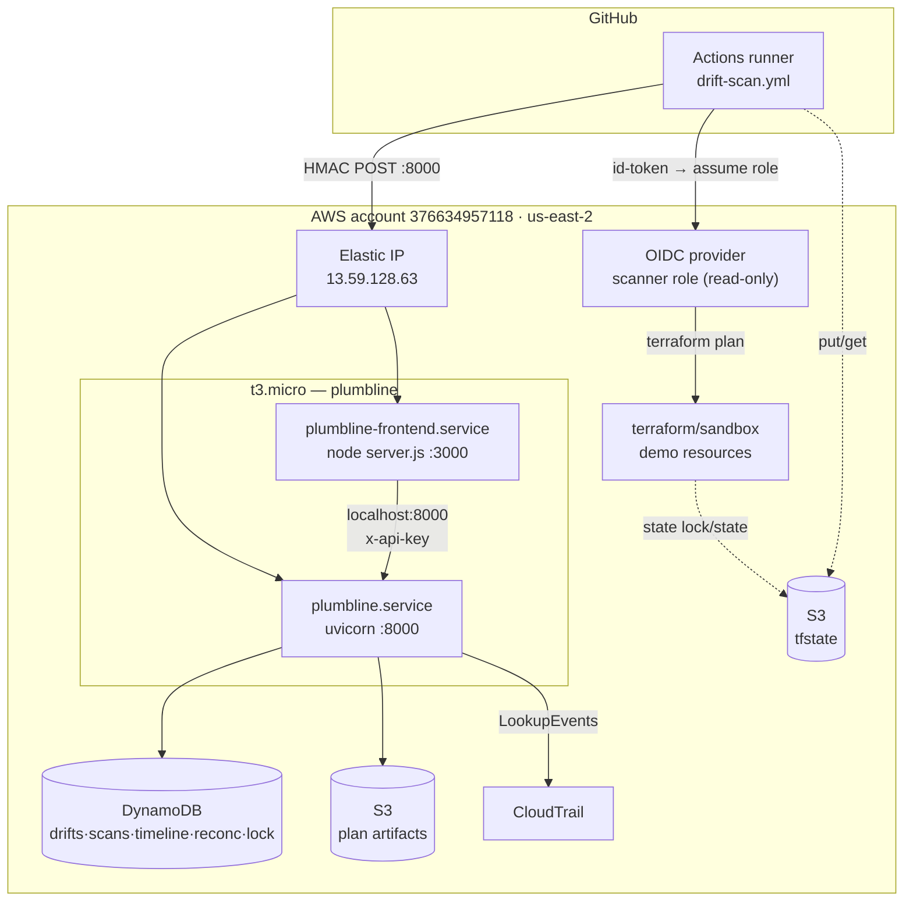

# PlumbLine architecture

Five views of the system: the ingest sequence, the drift lifecycle, the domain
model, the backend layering, and the deployed topology. All diagrams are
Mermaid — they render on GitHub and live in version control.

## System context

PlumbLine sits between a scheduled Terraform plan and the engineer who has to
explain what changed. Terraform does the detection; PlumbLine does the
investigation.

## Ingest sequence

The ordered stages of one scan — from scheduled trigger to persisted,
attributed drift event. Each stage is deterministic.

PR-triggered runs stop before ingest: they generate a plan for review but
**never** create drift incidents — developer config changes are not drift.

## Drift lifecycle

The state machine every `DriftEvent` follows. Scan-driven transitions
(re-observe / supersede / resolve) apply to every non-terminal status; API
actions are guarded by a stale-drift check (`409 STALE_DRIFT`).

## Domain model

The aggregates and value objects in `backend/app/domain/models.py`. This is
the shared contract between ingestion, risk, persistence, and the REST API
the frontend consumes — nothing here is produced by an LLM.

## Backend layering

Ports-and-adapters: the domain is storage- and provider-agnostic. `memory.py`
and `dynamodb.py` implement the same `Repositories` interface; `IaCRunner`
keeps the Terraform/OpenTofu engine swappable.

## Deployment topology

One `t3.micro` co-hosts both services behind a single Elastic IP; the UI's
server-side fetches never leave the box. CI authentication is OIDC — there
are no long-lived AWS keys anywhere.

`user_data_replace_on_change` replaces the instance on every deploy; the EIP
re-associates automatically so public URLs are stable. Secrets arrive via SSM
SecureString at bootstrap — never in user data, state, or the repo.

## Reading order for a new engineer

1. `backend/app/domain/models.py` — the shared vocabulary
2. `backend/app/parsers/terraform_plan.py` — `resource_drift` extraction
3. `backend/app/services/drift/pipeline.py` — the ordered ingest stages
4. `backend/app/services/risk/` + `services/drift/replay.py` — scoring + timeline
5. `backend/app/services/remediation/` — preview, proposal, policy
6. `frontend/lib/types.ts` — the mirror of the domain the UI trusts
