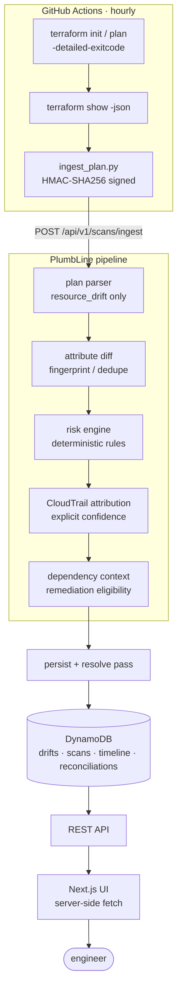
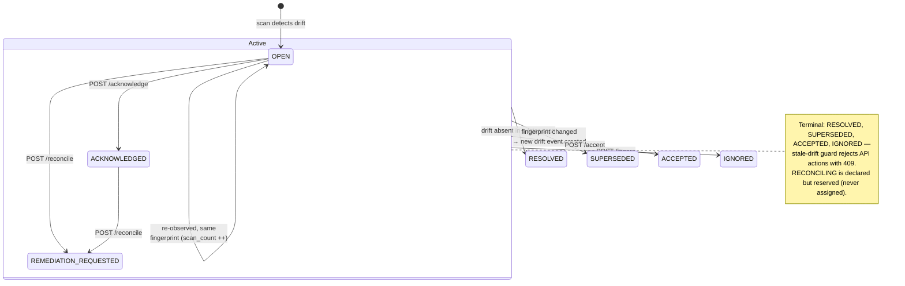

# PlumbLine

> New here? Read **[GETTING_STARTED.md](GETTING_STARTED.md)** — a plain-English
> walkthrough of what PlumbLine does and how to run it locally and on AWS.

PlumbLine is an AWS/Terraform infrastructure **drift investigation and
remediation platform**. It detects out-of-band modifications to
Terraform-managed AWS infrastructure, reconstructs the forensic story of what
happened (**Drift Replay**), scores risk deterministically, correlates AWS
CloudTrail evidence, and drives reconciliation through reviewable workflows.



Full diagrams — sequence, lifecycle, domain model (UML), deployment — in
**[ARCHITECTURE.md](ARCHITECTURE.md)**.

**Architectural principle:** Terraform is the detection engine. PlumbLine never
reimplements provider refresh or state comparison — it builds operational
intelligence around `terraform show -json`. An IaC execution abstraction
(`IaCRunner`, `backend/app/integrations/iac/runner.py`) keeps the engine
swappable (Terraform today; OpenTofu is interface-compatible but untested).

## Why not just `terraform plan`?

`terraform plan` tells you the state differs. PlumbLine answers the
operational questions:

- What changed? → leaf-level attribute diffs (`ingress[0].cidr_blocks[0]`)
- How did it likely happen? → Drift Replay timeline
- Who/what changed it? → CloudTrail correlation with explicit confidence
- Why does it matter? → deterministic, explainable risk rules
- What could it affect? → "Known Dependency Impact" (Terraform-derived)
- What's the safest reconciliation? → Remediation Preview + allowlisted policy

## Drift Replay

The signature feature. Each drift event owns a normalized timeline —
`SCAN_STARTED → PLAN_GENERATED → BASELINE_CONFIRMED → CLOUD_CHANGE →
CLOUDTRAIL_EVENT → DRIFT_CONFIRMED → RISK_CLASSIFIED → … → DRIFT_RESOLVED`.

Every timeline entry carries `certainty`: `confirmed` (backed by evidence)
vs `inferred` (clearly-marked reconstruction, e.g. an estimated change
window). The frontend renders these differently and never fabricates events.

## Critical drift semantics

PlumbLine reads **`resource_drift`** (out-of-band change observed during
refresh) separately from **`resource_changes`** (planned reconciliation of
config vs. reality). A developer intentionally editing `.tf` files produces
`resource_changes` only — **no drift incident is created**. This distinction
is fundamental and tested (`test_config_change_is_not_drift`).

## Risk engine

Deterministic, explainable rules (`backend/app/services/risk/`). Score 0–100,
each point attributed to a named rule with a message — e.g.
`SG_PUBLIC_SSH +35`, `IAM_ADMIN_LIKE +45`, `GEN_RESOURCE_DELETED +30`.

Severity bands: `0 INFO · 1–24 LOW · 25–49 MEDIUM · 50–74 HIGH · 75+ CRITICAL`.

Specialized analyzers:
- **Security groups** — public SSH/RDP, `0.0.0.0/0` / `::/0`, all-protocol
  ingress, database ports, boundary widened/narrowed, rules added/removed.
  Context matters: removing a rule is not scored like opening SSH to the world.
- **IAM** — `Action:"*"`, `Resource:"*"`, admin-like grants, AdministratorAccess
  attachment, trust-policy principal widening, privilege escalation/reduction.
  Policy documents are compared as parsed statement sets, never as strings.

## CloudTrail attribution

Best-effort, deterministic confidence scoring (`enricher.py`):
resource-identifier match +0.50, known mutating API +0.20, time proximity
+0.05–0.15, region +0.05, account +0.05; failed API calls cap at 0.35.
If confidence < 0.3, the actor is reported as **unknown** — never fabricated.

## Remediation

Two paths, both behind explicit review:

1. **RESTORE_DESIRED** — `terraform apply` reconciles reality back to config.
   Auto-remediation exists as a **policy layer** (`policy.py`), is
   **disabled by default**, and only fires for narrow allowlisted patterns
   (tag-only drift on allowlisted types; revoking added public SG rules).
   Destructive actions and stale plans are always blocked.
2. **ACCEPT_DRIFT** — deployed reality is intentional. PlumbLine builds a
   `ReconciliationProposal` with structured suggested changes (never naive
   string rewriting) and optionally opens a GitHub PR with an evidence file.
   Only a narrow set of resource types produce generated suggestions;
   everything else fails safely to `unsupported` + manual review.

**Stale-drift protection:** remediation against a superseded event, a changed
fingerprint, or a mismatched plan hash is rejected with `409 STALE_DRIFT` —
a fresh scan is required.

**Remediation Preview** (`GET .../remediation-preview`) reports predicted
actions, modified/destroyed/replaced counts, known dependents, risk
before/after, downtime *indicators* (never a zero-downtime promise),
confidence, and reasoning.

## Idempotency

A deterministic SHA-256 fingerprint (environment + resource address +
normalized attribute diffs, sensitive values excluded) dedupes repeated
scans: identical drift updates `last_seen_at`/`scan_count`; materially
different drift on the same resource supersedes the old event; drift that
disappears resolves the event.

## Drift lifecycle

Every drift event is a state machine — scans drive some transitions, the API
drives the rest:



## API

FastAPI (`backend/app/main.py`). Highlights:

| Endpoint | Purpose |
|---|---|
| `POST /api/v1/scans/ingest` | HMAC-signed CI plan upload |
| `GET /api/v1/drifts` | list + filters (env/region/type/service/severity/status) |
| `GET /api/v1/drifts/{id}` | normalized drift event |
| `GET /api/v1/drifts/{id}/timeline` | Drift Replay |
| `GET /api/v1/drifts/{id}/dependencies` | Known Dependency Impact |
| `GET /api/v1/drifts/{id}/remediation-preview` | predicted reconciliation |
| `POST /api/v1/drifts/{id}/reconcile \| accept \| ignore \| acknowledge` | lifecycle |
| `GET /api/v1/overview` | dashboard aggregates |
| `GET /health`, `GET /metrics` | ops |

Ingest auth: `X-Plumbline-Signature` = HMAC-SHA256(`<ts>.<body>`) with a 5-min
timestamp window. Plan bodies are capped (default 20 MiB). Sensitive values
flagged by Terraform's `*_sensitive` masks are redacted by the CI uploader
*and* again server-side (defense in depth).

## Frontend — investigation UI

Next.js 15 (App Router) + TypeScript + Tailwind v4 in `frontend/` — a dark,
dense "operational control plane" built on the API contract above.

- **Overview** (`/`) — health headline → "Needs attention" (the single most
  important drift) → derived Drift Health score (formula shown) → severity
  mix, recent scans, recently resolved.
- **Drift Explorer** (`/drifts`) — compact filter bar (`/` to search,
  multi-select severity/status/service), sortable + density-toggleable
  table, and a right-side **row inspector** for triage without navigation.
- **Incident** (`/drifts/:id`) — the flagship page: selectable **Drift
  Replay** (confirmed = solid, inferred = dashed) where clicking an event
  opens its evidence inspector; structured SG/IAM diffs (firewall rules read
  like rules, not JSON paths; `0.0.0.0/0` flagged as public); **explainable
  risk score**; expandable attribution-confidence evidence; remediation
  slide-over with a meaningful confirmation; focus mode; prev/next
  quick-switcher.
- **⌘K command palette** — searches Terraform addresses, scan IDs,
  severities; "Run scan" links to the real workflow dispatch page.
- Plus: global **Timeline** feed, **Scans** audit trail + detail,
  **Reconciliations**, **Infrastructure** (resources observed through plans),
  **Settings**.

Data boundaries: the UI never decides drift, risk, confidence, or
remediation eligibility — those come from the backend. Mutations proxy
through server-side route handlers that attach `x-api-key`; secrets never
reach the browser. Unknown actors render as unknown — nothing is invented.

## Repository layout

```
ARCHITECTURE.md     Diagrams: context, sequence, lifecycle, domain model, deployment
backend/app/        FastAPI app (api, domain, parsers, services, repositories, integrations)
backend/tests/      pytest suite + sanitized plan-JSON fixtures
frontend/           Next.js investigation UI (see frontend/README.md)
terraform/sandbox/  small demo env (SG+EC2+S3+IAM+Lambda) for real drift
terraform/plumbline/ platform infra (DynamoDB, S3, OIDC scanner role, API role)
scripts/ingest_plan.py  stdlib-only HMAC-signed plan uploader for CI
scripts/local_scan.sh   one-command private scan: plan → ingest → done
.github/workflows/drift-scan.yml  scheduled scan via GitHub OIDC
```

## Local development

```bash
cd backend
python3 -m venv .venv && .venv/bin/pip install -e ".[dev]"
cp .env.example .env        # storage_backend=memory needs no AWS
.venv/bin/uvicorn app.main:app --reload
.venv/bin/python -m pytest tests -q     # 77 tests
```

## Self-hosted & fully private

PlumbLine can run entirely on your own machine against your own Terraform —
**no AWS account, no external calls, no telemetry**. Clone it, and everything
stays on your disk.

```bash
cd backend
python3 -m venv .venv && .venv/bin/pip install -e .
PLUMBLINE_STORAGE_BACKEND=sqlite .venv/bin/uvicorn app.main:app --port 8000
```

Then scan any Terraform directory in one command:

```bash
scripts/local_scan.sh path/to/your/terraform        # → plan → ingest → done
```

The `sqlite` backend keeps drifts, scans, replay timelines, and
reconciliations in a single `plumbline.db` file — history survives restarts
(`memory` works too but forgets on exit). Data boundaries that hold in AWS
hold here: nothing is uploaded anywhere, auth escape-hatches apply only to
local backends, and CloudTrail attribution runs only if your ambient AWS
credentials allow it — otherwise events report `unknown`, honestly.

Frontend:

```bash
cd frontend
npm install
cp .env.example .env.local   # PLUMBLINE_API_URL + PLUMBLINE_API_KEY
npm run dev                  # → http://localhost:3000
```

Try a scan locally:
```bash
curl -X POST localhost:8000/api/v1/scans/ingest -H 'content-type: application/json' \
  -d "$(python3 -c 'import json;print(json.dumps({"environment":"dev","terraform_exit_code":2,"plan_json":json.load(open("tests/fixtures/plan_sg_ssh_open.json"))}))')"
curl localhost:8000/api/v1/drifts
```

## AWS deployment

- `terraform/plumbline` provisions: 4 DynamoDB tables, plan-artifact + tfstate
  S3 buckets, a **GitHub OIDC provider + read-only scanner role**
  (`drift-scan.yml` assumes it — no long-lived AWS keys), and a separate
  least-privilege API instance role (DynamoDB rw on PlumbLine tables, S3
  artifact read, `cloudtrail:LookupEvents`).
- `terraform/sandbox` applies a small, intentionally drifty resource set —
  e.g. an SG allowing only HTTPS. Add `tcp/22 0.0.0.0/0` in the console and
  the next scheduled scan produces a classified, attributed drift incident.
- Backend runs wherever Python runs (EC2 + instance profile is the reference
  target). Set `PLUMBLINE_STORAGE_BACKEND=dynamodb` + env vars per
  `.env.example`. Detection is read-only; remediation is a separate IAM
  boundary and off by default.
- **UI + API are co-located on one EC2 instance.** The frontend ships as a
  Next.js standalone bundle via the same S3-artifact pattern as the backend;
  `user_data` installs Node 20 and runs a second systemd unit
  (`plumbline-frontend`, port 3000) whose server-side fetches hit
  `http://localhost:8000`. An Elastic IP pins the public endpoint across the
  instance replacements that `user_data_replace_on_change` produces, so the
  URLs in `terraform output` never change. To redeploy: `npm run build` in
  `frontend/`, then `terraform apply` in `terraform/plumbline`.

## Security posture

- No credentials in code: OIDC for CI, instance profiles for runtime, env
  vars/secret stores for tokens.
- HMAC-signed ingest; API key on mutation endpoints; body-size caps.
- Sensitive plan values redacted before upload and again at ingest;
  fingerprints never contain plaintext sensitive values.
- Everything is validated input → parsed models; no shell strings built from
  API input; IaC runs as argument-list subprocesses only.

## Limitations (honest list)

- Dependency analysis is **Terraform-declared only** (references +
  `depends_on`) — labeled "Known Dependency Impact", not an AWS blast-radius
  graph. Manually-created resources Terraform doesn't manage are invisible.
- CloudTrail attribution is best-effort correlation: ~90-day event history,
  identifier matching, explicit confidence — unknown is a valid outcome.
- Auto-remediation is a policy layer only; actual `terraform apply`
  execution is expected to run in CI (the stored plan must still match —
  staleness is enforced).
- ACCEPT_DRIFT generates *review artifacts* for a narrow resource set; it
  does not rewrite arbitrary Terraform.
- In-memory repository is for local dev/tests; DynamoDB is the deployed
  backend. Optimistic-concurrency on drift records is not implemented —
  documented as future work.
- OpenTofu is interface-compatible via `IaCRunner` but **untested**.
- Single-account/single-region-per-scan in V1; multi-region is ingested per
  region via repeated scans.

## License / third-party

See `THIRD_PARTY_NOTICES.md` — dependencies are used as packages or external
executables; no third-party source is vendored. AWS's
`sample-terraform-drift-detection` (MIT-0) and `driftctl` (Apache-2.0) were
studied as architectural references only.
